# PathSnap — Review 1 summary

**Task:** for each GPS fix, rank the nearby road arcs (candidates) and pick the true one. The pipeline is a classifier followed by HMM/Viterbi.
**Data:** 80 training trips (208,417 fixes), used for 5-fold GroupKFold CV grouped by trip. 10 student-test trips (19,160 fixes).

## 1. Models used (6) and metrics

| # | Model | Family | Key configuration | CV macro F1 (±sd) | Test Top-1 | Test macro F1 | Test log loss | Route continuity | Train time | Inference |
|---|---|---|---|---|---|---|---|---|---|---|
| 1 | Gaussian Naive Bayes | Probabilistic | var_smoothing 1e-9 | 0.842 ± 0.030 | 0.842 | 0.842 | 0.608 | 0.927 | 0.6 s | 0.003 ms/fix |
| 2 | Logistic Regression | Linear | StandardScaler, L2, C = 1 | 0.918 ± 0.013 | 0.872 | 0.919 | 0.102 | 0.933 | 4.5 s | 0.003 ms/fix |
| 3 | KNN | Instance-based | k = 31, distance-weighted | 0.919 ± 0.013 | 0.869 | 0.922 | 0.120 | 0.938 | 0.1 s | 2.06 ms/fix |
| 4 | MLP | Neural network | (64, 32), Adam, early stopping | 0.932 ± 0.009 | 0.886 | 0.932 | 0.076 | 0.945 | 55 s | 0.008 ms/fix |
| 5 | Random Forest | Bagging ensemble | 200 trees, depth 18 | 0.936 ± 0.010 | 0.897 | 0.937 | 0.069 | 0.944 | 101 s | 0.038 ms/fix |
| 6 | **LightGBM** | Gradient boosting | 400 trees, lr 0.05, 63 leaves | **0.937 ± 0.012** | **0.905** | **0.943** | **0.067** | **0.951** | 48 s | 0.049 ms/fix |

**Metric definitions**
- **Top-1:** the share of GPS fixes where the highest-scored candidate is the reference arc.
- **Macro F1 / log loss:** measured on the candidate classification (is this arc the true one?).
- **Route continuity:** the share of consecutive predicted arcs that are actually connected on the road network.

**Selected model: LightGBM.** It is best on every metric, and it has the lowest log loss. Low log loss means its probabilities are reliable, which matters because the HMM uses them. It also generalises well.

## 2. Model comparison graphs

### Cross-validation macro F1 (5 folds, train partition)
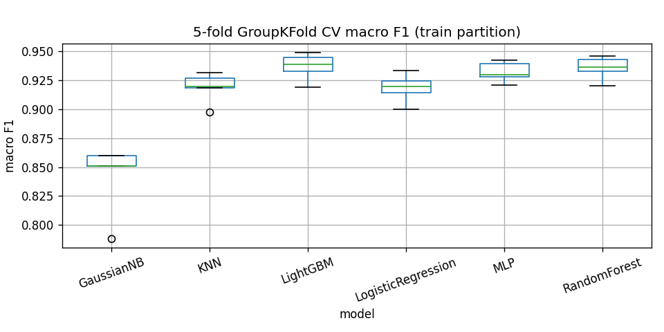

### Student-test Top-1 accuracy and macro F1
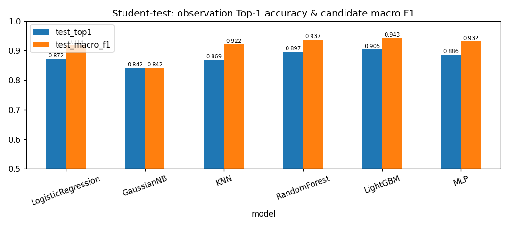

### Over- and underfitting check
KNN scores 1.0 on its own training data but only 0.92 on test, so it overfits. Naive Bayes is low everywhere, so it underfits.
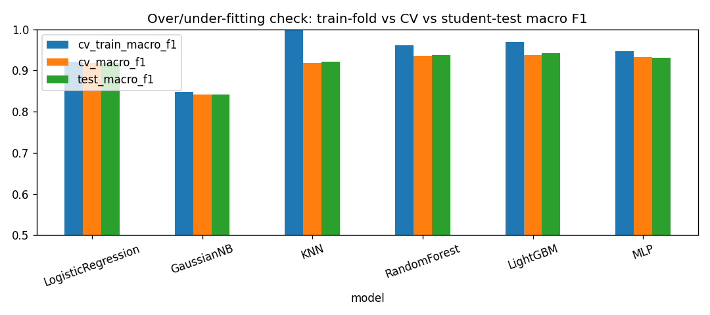

### Log loss
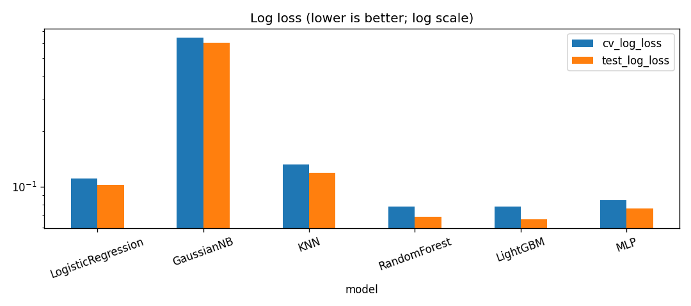

### Accuracy vs inference time
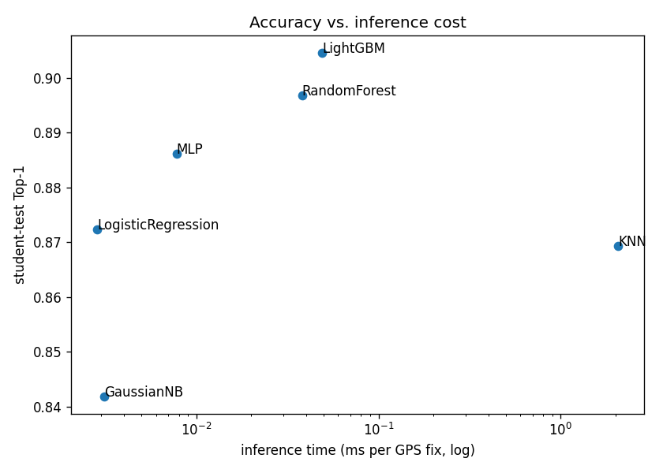

### Training curves (only for models that train epoch by epoch)
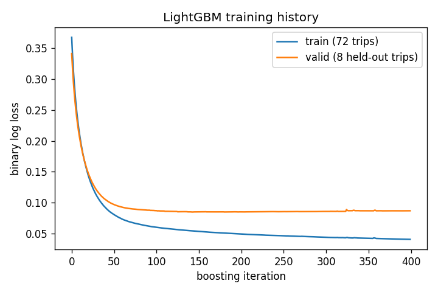
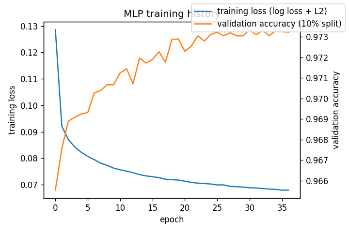

### Confusion matrices (student-test candidates)
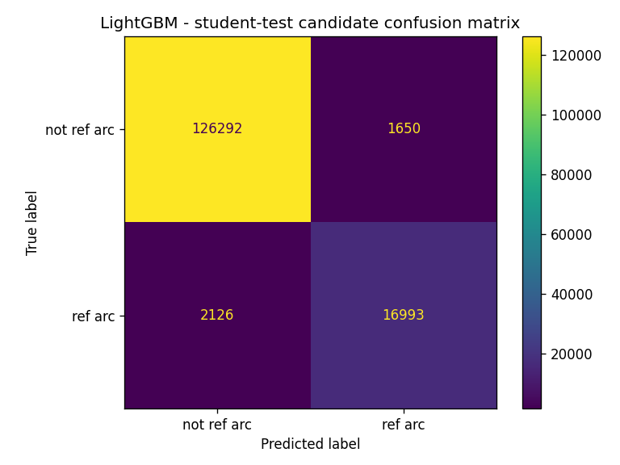
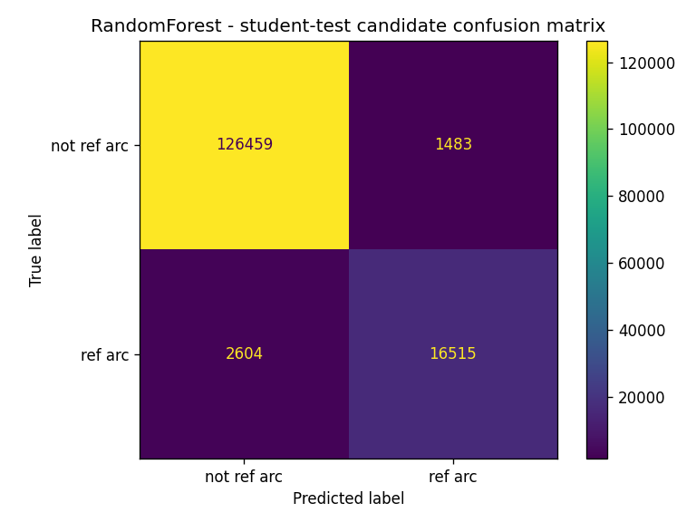
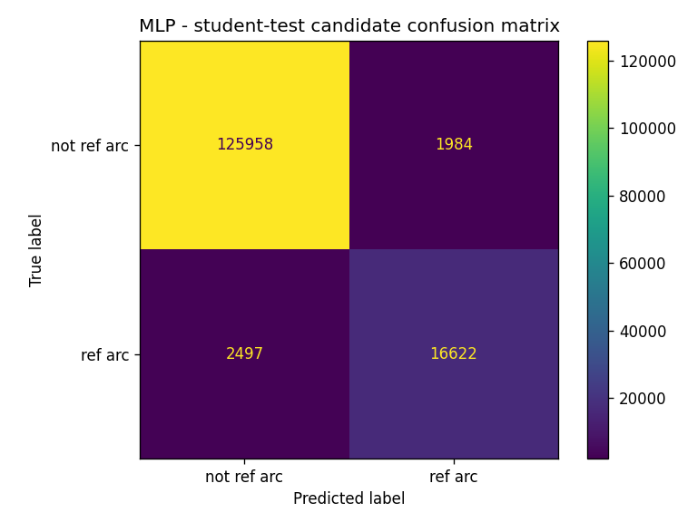
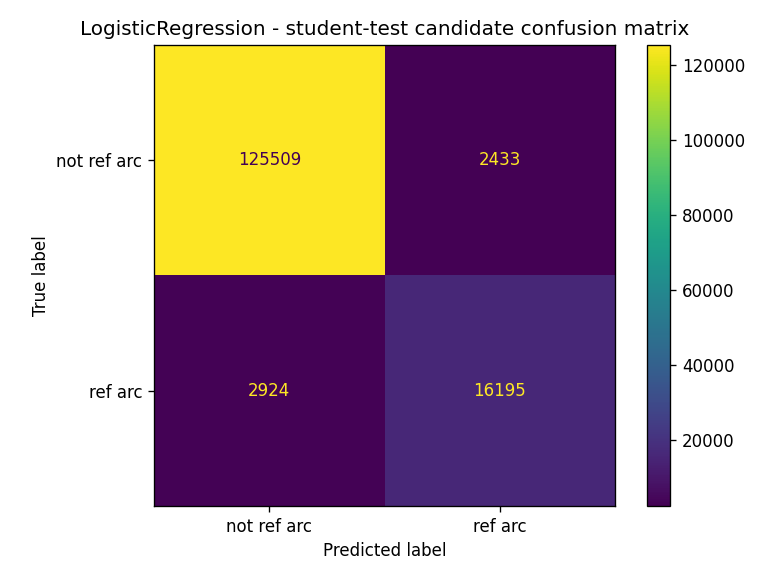
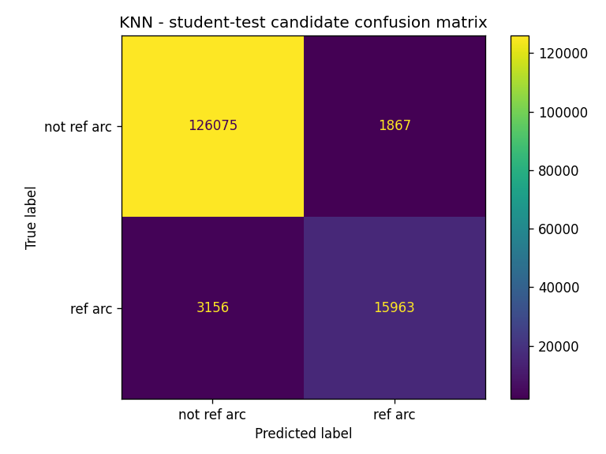
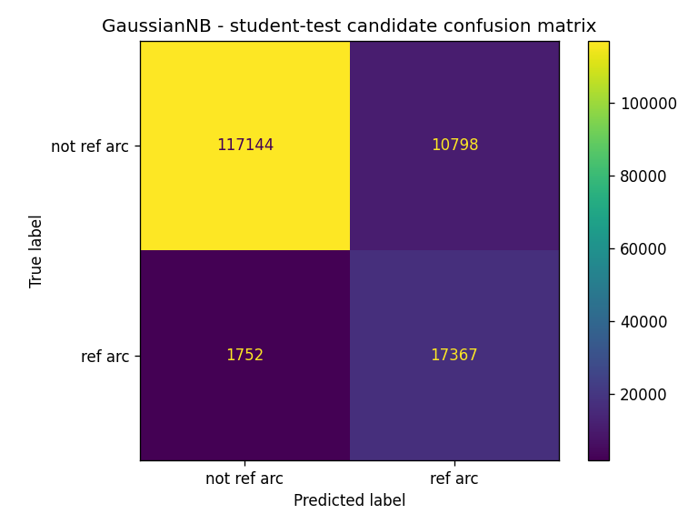

## 3. Bayesian hyperparameter optimisation (LightGBM, Optuna TPE)

| | CV macro F1 | CV log loss | Test Top-1 | Test macro F1 | Test log loss |
|---|---|---|---|---|---|
| Untuned | 0.9388 | 0.0770 | 0.9046 | 0.9426 | 0.0667 |
| Tuned | 0.9389 | 0.0752 | 0.9021 | 0.9431 | 0.0657 |

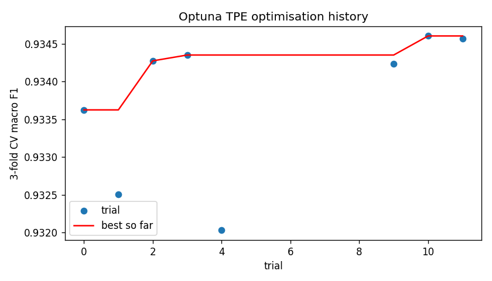
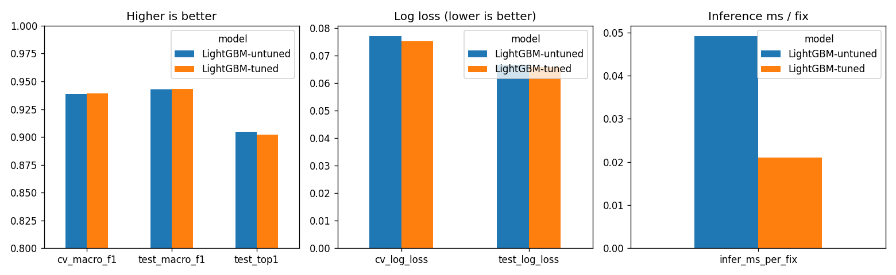

## 4. HMM / Viterbi vs classifier only (student test)

| | Classifier only | Classifier + HMM |
|---|---|---|
| Top-1 accuracy | 0.902 | **0.926** |
| Route continuity | 0.953 | **0.979** |
| Route F1 | 0.956 | **0.983** |

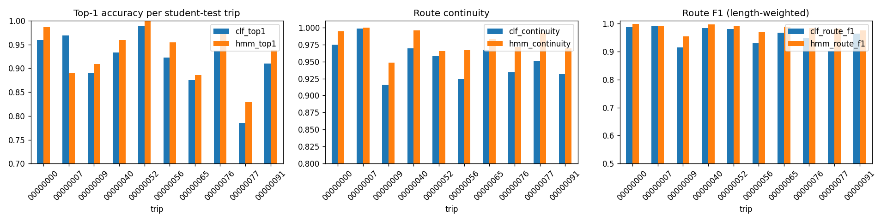

## 5. EDA

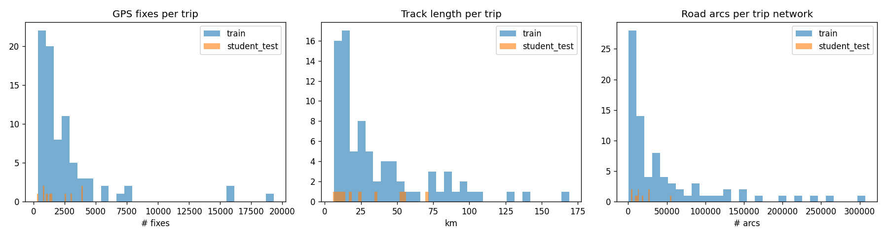
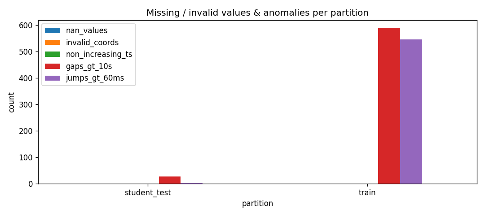
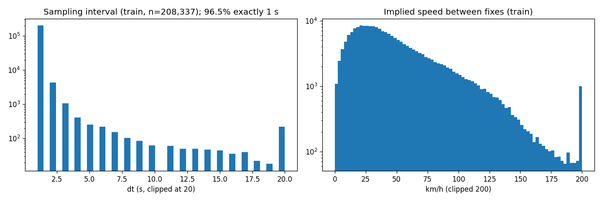
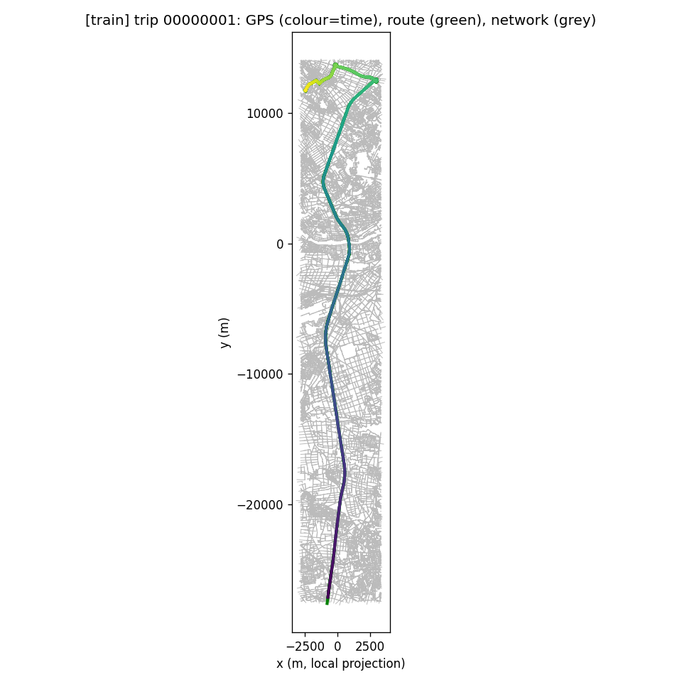
